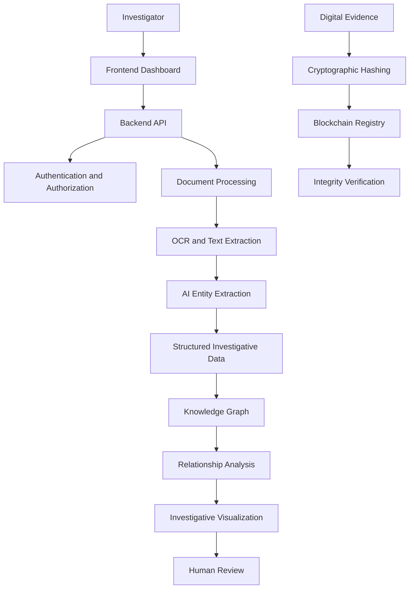

<div align="center">

# TRACIA
### Trace. Analyze. Connect. Intelligence Architecture.

**AI-Powered Criminal Network Analysis System**

Transforming fragmented investigative data into connected, explainable, and verifiable intelligence.

[🚀 Live Demo](https://tracia-frontend-ne6u-qi7ubw8tr.vercel.app/login?next=%2F) · [💻 GitHub Repository](https://github.com/lakshiii08/Tracia)


</div>

---

## Table of Contents

- [Overview](#overview)
- [Problem Statement](#problem-statement)
- [Our Vision](#our-vision)
- [Key Features](#key-features)
- [System Architecture](#system-architecture)
- [Technology Stack](#technology-stack)
- [Project Structure](#project-structure)
- [How TRACIA Works](#how-tracia-works)
- [Blockchain Evidence Integrity](#blockchain-evidence-integrity)
- [Live Demo](#live-demo)
- [Getting Started](#getting-started)
- [Admin Demo Access](#admin-demo-access)
- [Security and Privacy](#security-and-privacy)
- [Use Cases](#use-cases)
- [Future Roadmap](#future-roadmap)
- [Contributing](#contributing)
- [Project Information](#project-information)
- [Disclaimer](#disclaimer)
- [License](#license)

---

## Overview

**TRACIA (Trace. Analyze. Connect. Intelligence Architecture)** is an AI-powered investigative intelligence platform designed to help law enforcement agencies analyze criminal records, identify potential connections, and visualize complex networks across multiple sources of information.

Modern investigations may involve FIRs, call detail records, financial records, vehicle information, location data, and other investigative documents. Analyzing these sources independently can make it difficult to uncover relationships and patterns across cases.

TRACIA aims to bring fragmented investigative information into a unified analytical environment using artificial intelligence, document processing, knowledge graphs, relationship analysis, and blockchain-based evidence integrity verification.

### Our Mission

To help investigators move from fragmented records to connected intelligence through explainable analysis, structured information, and verifiable digital evidence.

---

## Problem Statement

**AI-Powered Criminal Network Analysis System**

Investigative workflows can face several challenges:

- Fragmented information across different records and data sources.
- Time-consuming manual review of investigative documents.
- Difficulty extracting structured information from unstructured reports.
- Limited visibility into relationships between entities across cases.
- Challenges in identifying potentially significant connections between people, locations, vehicles, phone numbers, and financial transactions.
- Need for reliable verification of digital evidence integrity.
- Lack of a unified interface for exploring connected investigative information.

TRACIA aims to address these challenges through a centralized, AI-assisted investigative analysis workflow.

---

## Our Vision

TRACIA is designed around three core principles:

### Trace
Extract and organize relevant information while preserving links to original sources wherever supported.

### Analyze
Use AI-assisted processing and graph-based exploration to help investigators examine relationships and identify potential leads.

### Connect
Bring entities and relationships together into a unified investigative intelligence environment.

---

## Key Features

### 1. AI-Powered Document Intelligence

- Process supported investigative documents.
- Extract text from digital and scanned documents using OCR where configured.
- Identify entities such as people, locations, phone numbers, vehicles, and organizations.
- Transform unstructured text into structured information.
- Retain source references and confidence indicators where supported.
- Enable investigators to review extracted information against original documents.

### 2. Criminal Network Analysis

- Represent entities as nodes and relationships as edges.
- Explore direct and indirect connections between entities.
- Visualize relationships across investigative records.
- Investigate connections involving people, locations, vehicles, and organizations.
- Support graph-based exploration of complex networks.

### 3. Knowledge Graph and GraphRAG

- Organize investigative information into a connected knowledge graph.
- Retrieve relevant relationship context for analytical queries.
- Explore relationships across multiple records.
- Support source traceability where available.
- Provide a foundation for explainable, relationship-oriented investigation.

### 4. Interactive Investigative Dashboard

- Centralized interface for investigative workflows.
- Structured presentation of extracted intelligence.
- Entity and relationship exploration.
- Document and case-oriented workflows.
- Visual summaries of connected information.

### 5. Blockchain-Based Evidence Integrity

- Generate cryptographic hashes for digital evidence.
- Register evidence hashes using a configured blockchain network.
- Verify file integrity by comparing computed and registered hashes.
- Retain transaction references for subsequent verification.

Blockchain verification can help determine whether a file matches its registered content. It does not independently prove that the original evidence was authentic or legally admissible.

### 6. Authentication and Access Control

- Authentication for authorized users.
- Role-based access control where implemented.
- Protected backend endpoints.
- Controlled access to sensitive investigative information.
- Secure handling of application configuration and credentials.

### 7. Modular Architecture

TRACIA separates its frontend, backend, AI processing, and blockchain components to support independent development, testing, and future integration.

---

## System Architecture



*This diagram illustrates the intended logical architecture. Actual integrations depend on the components configured in the deployed version.*

---

## Technology Stack

| Component | Technologies |
|---|---|
| Frontend | React, JavaScript, CSS |
| Frontend Deployment | Vercel |
| Backend | Python, FastAPI |
| AI Processing | OCR, NLP, LLM-based extraction |
| Knowledge Graph | Neo4j, GraphRAG |
| Database | SQLAlchemy-compatible database |
| Smart Contracts | Solidity |
| Blockchain Development | Hardhat |
| Blockchain Integration | Web3.py |
| Contract Access Control | OpenZeppelin |
| Document Processing | PyMuPDF |
| Authentication | JWT and role-based access control |
| Version Control | Git and GitHub |

*The table describes the project's technology stack and intended integrations. Verify the dependencies in each module before treating every item as implemented.*

---

## Project Structure

```text
Tracia/
│
├── frontend/
│   └── Web application and investigative dashboard
│
├── backend/
│   └── Backend APIs and application services
│
├── AI/
│   └── AI processing and intelligence modules
│
├── blockchain/
│   └── Smart contracts and evidence integrity
│
└── README.md
```

Directory descriptions are logical summaries. Refer to the actual project folders for implementation details and setup requirements.

---

## How TRACIA Works

### Step 1 — Document Ingestion

An authorized investigator uploads a supported investigative document.

### Step 2 — Text Extraction

The processing pipeline extracts readable text using document parsing or OCR.

### Step 3 — Entity Extraction

The AI pipeline identifies relevant entities and candidate relationships from the extracted content.

### Step 4 — Data Structuring

Extracted information is organized into structured records, retaining source references where available.

### Step 5 — Knowledge Graph Construction

Entities and their relationships are represented as a graph for connected exploration.

### Step 6 — Relationship Analysis

Investigators explore direct and indirect connections and review patterns that may warrant further investigation.

### Step 7 — Evidence Integrity Verification

Digital evidence can be hashed and registered through the configured blockchain component for subsequent integrity checks.

### Step 8 — Investigator Review

Investigators validate analytical findings against source documents before making operational decisions.

---

## Blockchain Evidence Integrity

TRACIA includes a blockchain component intended to support digital evidence integrity verification.

### Verification Workflow

1. Select a digital evidence file.
2. Calculate its cryptographic hash.
3. Register the hash using the configured smart contract.
4. Retain the blockchain transaction or registration reference.
5. Recalculate the hash when verification is required.
6. Compare the computed hash against the registered hash.

A matching hash indicates that the checked file matches the registered content, assuming the hashing and registration process is trustworthy.

### Why Blockchain?

- Provides a tamper-evident record of registered hashes.
- Supports subsequent integrity verification.
- Helps establish whether a file has changed since registration.
- Can improve the auditability of evidence-verification workflows.

**Privacy principle:** Avoid placing confidential evidence, personal information, or sensitive investigative records on a public blockchain. Store only the minimum necessary verification metadata.

---

## Live Demo

Explore the deployed TRACIA frontend:

### [🚀 Launch TRACIA Application](https://tracia-frontend-ne6u-qi7ubw8tr.vercel.app/login?next=%2F)

**Source Code:** [github.com/lakshiii08/Tracia](https://github.com/lakshiii08/Tracia)

The live application provides access to the deployed frontend. Availability of backend services and individual features depends on the current deployment configuration.

---

## Getting Started

### Prerequisites

Install the tools required by the modules you intend to run:

- Git
- Node.js and npm
- Python 3
- A compatible database or graph service, if required
- Hardhat-compatible tooling for blockchain development

### 1. Clone the Repository

```bash
git clone https://github.com/lakshiii08/Tracia.git
cd Tracia
```

### 2. Frontend Setup

```bash
cd frontend
npm install
```

Start the development server using the script defined in the frontend's `package.json`. If the project uses a `dev` script:

```bash
npm run dev
```

### 3. Backend Setup

Open a separate terminal:

```bash
cd backend
python -m venv .venv
```

Activate the virtual environment.

**Windows PowerShell**

```powershell
.venv\Scripts\Activate.ps1
```

**macOS/Linux**

```bash
source .venv/bin/activate
```

If the backend contains a `requirements.txt` file:

```bash
pip install -r requirements.txt
```

For a FastAPI application whose entry point is `main.py` and whose ASGI application object is named `app`, the development server can be started with:

```bash
uvicorn main:app --reload
```

Adjust the command to match the actual application entry point.

### 4. AI Module Setup

Inspect the `AI/` directory for its dependency files, model configuration, and application entry point.

Install the dependencies specified by that module and configure any required OCR tools, model providers, or graph connections.

### 5. Blockchain Module Setup

```bash
cd blockchain
npm install
```

Use the compilation and deployment commands supported by the Hardhat version configured in the module.

Configure the RPC endpoint, network, and contract address through environment variables.

> **Note:** These are setup templates. Actual commands depend on the dependency files, package scripts, and entry points present in your repository.

---

## Admin Demo Access

For authorized demonstrations, configure a dedicated test administrator account.

| Field | Demo value |
|---|---|
| User ID | `ADMIN` |
| Password | `Adnin@123` |

These credentials work only if the deployed application has been configured to accept them.

**Security warning:** Do not use these credentials for a production administrator account. Since this README is public, use a restricted demo account and rotate any password that has been exposed. Prefer sharing demo access privately with authorized reviewers.

Never commit production passwords, API keys, private keys, or other secrets to GitHub.

---

## Security and Privacy

TRACIA is intended for investigative workflows that may involve sensitive information.

Recommended safeguards include:

- Strong authentication and server-side authorization.
- Least-privilege role assignments.
- Secure password hashing.
- HTTPS for deployed services.
- Encryption in transit and at rest.
- Input validation and safe file-upload handling.
- Audit logging for sensitive actions.
- Environment-based secret management.
- Controlled access to investigative documents.
- Source traceability for AI-extracted information.
- Human review of AI-generated findings.
- Compliance with applicable data-protection and legal requirements.

AI-generated relationships must be treated as investigative leads, not independent proof of criminal activity. False matches, incomplete records, and extraction errors must be considered.

---

## Potential Use Cases

- Cross-referencing entities across investigative records.
- Exploring relationships between people, locations, vehicles, and organizations.
- Identifying connections that warrant further investigation.
- Structuring information extracted from unstructured documents.
- Exploring connected information across multiple cases.
- Verifying whether digital evidence matches its registered hash.

Use must comply with applicable law, authorization requirements, data-protection obligations, and human oversight.

---

## Future Roadmap

Potential future enhancements include:

- Multilingual investigative document processing.
- Improved OCR for scanned documents.
- Advanced entity resolution and duplicate detection.
- More explainable graph analytics.
- Improved source-level citations and provenance.
- Secure integration with authorized external systems.
- Expanded evidence lifecycle management.
- Comprehensive automated testing.
- Continuous integration and deployment.
- Performance improvements for large knowledge graphs.

---

## Contributing

Contributions and suggestions are welcome.

1. Fork the repository.
2. Create a feature branch.
3. Implement your changes.
4. Test the affected modules.
5. Open a pull request describing the changes.

Please do not include confidential records, personal data, passwords, private keys, or API tokens in commits, issues, or pull requests.

---

## Project Information

| Field | Details |
|---|---|
| Project Name | TRACIA |
| Full Form | Trace. Analyze. Connect. Intelligence Architecture |
| Domain | AI, Investigative Intelligence, Graph Analytics, Blockchain |
| Team | Spinny |
| Competition | Smart India Hackathon 2026 |
| Problem Statement | AI-Powered Criminal Network Analysis System |
| Live Demo | [Launch Application](https://tracia-frontend-ne6u-qi7ubw8tr.vercel.app/login?next=%2F) |
| GitHub | [lakshiii08/Tracia](https://github.com/lakshiii08/Tracia) |

---

## Disclaimer

TRACIA is an investigative decision-support project. It is not a substitute for lawful investigative procedures, verified evidence, professional judgment, or judicial determination.

Its accuracy and capabilities depend on the quality of source data and the features implemented in the deployed version.

---

## License

Add an appropriate license after the project team agrees on the terms of use and redistribution.

Until a license is specified, do not assume that the repository is available for unrestricted reuse or redistribution.

---

<div align="center">

### TRACIA
**Trace Connections. Strengthen Intelligence.**

*Built to support connected, explainable, and verifiable investigations.*

[Live Demo](https://tracia-frontend-ne6u-qi7ubw8tr.vercel.app/login?next=%2F) · [GitHub Repository](https://github.com/lakshiii08/Tracia)

</div>
