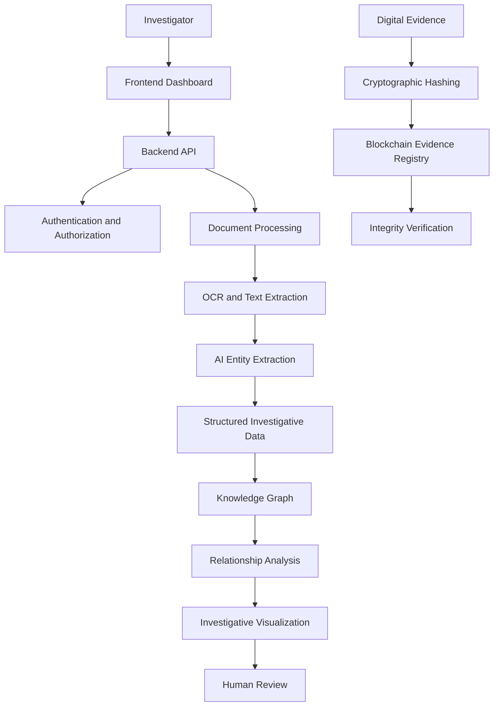

<div align="center">

# TRACIA
### Trace. Analyze. Connect. Intelligence Architecture.

**AI-Powered Criminal Network Analysis System**

Connecting fragmented investigative data into actionable, explainable intelligence.

[](https://github.com/lakshiii08/Tracia)
[](https://github.com/lakshiii08/Tracia)
[](https://github.com/lakshiii08/Tracia)
[](https://github.com/lakshiii08/Tracia)

</div>

---

## Overview

**TRACIA (Trace. Analyze. Connect. Intelligence Architecture)** is an AI-powered investigative intelligence platform designed to assist law enforcement agencies in analyzing criminal records, discovering hidden relationships, and visualizing interconnected networks across multiple sources of information.

Investigations often involve large volumes of FIRs, call detail records, financial records, vehicle information, location data, and other investigative documents. Analyzing these sources independently can make it difficult to identify meaningful connections.

TRACIA aims to unify these fragmented sources through artificial intelligence, knowledge graphs, relationship analysis, and blockchain-based evidence integrity verification.

### Our Mission

To transform fragmented investigative data into connected, explainable, and verifiable intelligence while keeping investigators in control of every critical decision.

---

## Problem Statement

**AI-Powered Criminal Network Analysis System**

Traditional investigative workflows can face challenges such as:

- Fragmented information distributed across multiple records and sources.
- Time-consuming manual document analysis and entity extraction.
- Difficulty identifying connections across suspects, locations, vehicles, phone numbers, and financial transactions.
- Limited visibility into relationships spanning multiple cases.
- Challenges in tracking the integrity of digital evidence.
- Lack of a unified interface for exploring interconnected investigative information.

TRACIA aims to address these challenges through a centralized, AI-assisted investigative analysis workflow.

---

## Key Features

### 1. AI-Powered Document Intelligence

- Process supported investigative documents.
- Extract text from digital and scanned documents using OCR where configured.
- Identify entities such as people, locations, phone numbers, vehicles, and organizations.
- Convert unstructured information into structured data.
- Retain source references and confidence indicators where supported.
- Enable investigators to review extracted information against original documents.

### 2. Criminal Network Analysis

- Represent entities as nodes and relationships as edges.
- Explore direct and indirect connections between entities.
- Visualize relationships across investigative records.
- Identify potentially significant patterns and connections.
- Support graph-based exploration of complex networks.

### 3. Knowledge Graph and GraphRAG

- Organize entities and relationships into a connected knowledge graph.
- Retrieve relevant relationship context for investigative queries.
- Explore connected information across multiple records.
- Support explainable analysis with source traceability where available.

### 4. Interactive Investigative Dashboard

- Centralized investigative workspace.
- Document and case-oriented workflows.
- Entity and relationship exploration.
- Visual representation of connected intelligence.
- Structured presentation of extracted information and analytical findings.

### 5. Blockchain-Based Evidence Integrity

- Generate cryptographic hashes for digital evidence.
- Register evidence hashes using the configured blockchain network.
- Verify file integrity by comparing computed and registered hashes.
- Maintain blockchain transaction references for verification.

Blockchain verification can help establish whether a file matches previously registered content. It does not, by itself, establish the authenticity or legal admissibility of the original evidence.

### 6. Secure Access and Authorization

- Authentication for authorized users.
- Role-based access control where implemented.
- Protected API endpoints.
- Controlled access to sensitive investigative information.
- Security-conscious handling of configuration and credentials.

### 7. Modular Architecture

Independent frontend, backend, AI, and blockchain modules support development, testing, and future integration.

---

## System Architecture



*This diagram describes the intended logical workflow. Actual capabilities depend on the components configured in the deployment.*

---

## Technology Stack

| Layer | Technologies |
|---|---|
| Frontend | React, JavaScript, CSS |
| Backend | Python, FastAPI |
| AI and NLP | OCR, NLP, LLM-based extraction |
| Knowledge Graph | Neo4j, GraphRAG |
| Database | SQLAlchemy-compatible database |
| Blockchain | Solidity, Hardhat, Web3.py |
| Smart Contract Security | OpenZeppelin |
| Document Processing | PyMuPDF |
| Authentication | JWT and role-based access control |
| Version Control | Git and GitHub |

*Confirm the dependencies in each module before treating every listed technology as implemented in the current version.*

---

## Repository Structure

```text
Tracia/
│
├── AI/
│   └── AI processing and intelligence modules
│
├── backend/
│   └── Backend services and APIs
│
├── blockchain/
│   └── Smart contracts and evidence integrity
│
├── frontend/
│   └── User interface and dashboard
│
└── README.md
```

---

## How TRACIA Works

### Step 1 — Document Ingestion

An authorized investigator uploads a supported investigative document.

### Step 2 — Text Extraction

The document-processing pipeline extracts readable content using document parsing or OCR.

### Step 3 — Entity Extraction

The AI pipeline identifies relevant entities and candidate relationships from the extracted text.

### Step 4 — Data Structuring

Extracted information is converted into structured records with source references where available.

### Step 5 — Knowledge Graph Construction

Entities and their relationships are represented in a graph for connected exploration.

### Step 6 — Relationship Analysis

Investigators explore direct and indirect connections and review patterns that may warrant further investigation.

### Step 7 — Evidence Integrity Verification

Digital evidence can be hashed and registered through the configured blockchain component for subsequent integrity checks.

### Step 8 — Investigator Review

Investigators validate analytical findings against source documents before making operational decisions.

---

## Blockchain Evidence Integrity

TRACIA's blockchain module is intended to support the integrity verification of digital evidence.

### Verification Workflow

1. Select a digital evidence file.
2. Calculate its cryptographic hash.
3. Register the hash using the configured smart contract.
4. Retain the transaction or registration reference.
5. Recalculate the hash when verification is required.
6. Compare the computed hash with the registered hash.

A matching hash indicates that the checked file matches the registered content, assuming the hashing and registration process is trustworthy.

**Security principle:** Sensitive evidence and personally identifiable information should not be placed on a public blockchain. Store only the minimum necessary verification metadata.

---

## Getting Started

### Prerequisites

Install the tools required for the modules you want to run:

- Git
- Node.js and npm
- Python 3
- A compatible database or graph service, if required
- Hardhat-compatible tooling for blockchain development

### 1. Clone the Repository

```bash
git clone https://github.com/lakshiii08/Tracia.git
cd Tracia
```

### 2. Frontend Setup

```bash
cd frontend
npm install
```

Start the development server using the script defined in the frontend's `package.json`. For projects configured with a `dev` script:

```bash
npm run dev
```

### 3. Backend Setup

Open a separate terminal:

```bash
cd backend
python -m venv .venv
```

Activate the virtual environment.

**Windows PowerShell**

```powershell
.venv\Scripts\Activate.ps1
```

**macOS/Linux**

```bash
source .venv/bin/activate
```

If the backend contains a `requirements.txt` file:

```bash
pip install -r requirements.txt
```

For a FastAPI application whose entry point is `main.py` and whose ASGI application object is named `app`, run:

```bash
uvicorn main:app --reload
```

Adjust the entry point to match the actual backend implementation.

### 4. AI Module Setup

Inspect the `AI/` directory for its dependency files, model configuration, and application entry point.

Install the dependencies specified by that module and configure any required model providers, OCR tools, or graph connections.

### 5. Blockchain Setup

```bash
cd blockchain
npm install
```

Use the compilation and deployment commands supported by the Hardhat version configured in this directory.

Configure the RPC endpoint, network, and contract address through environment variables.

> **Note:** These commands are starting templates. Refer to each module's package scripts, dependency files, and configuration for the exact commands required by your implementation.

---

## Admin Demo Login

For authorized demonstrations, configure a dedicated test administrator account.

| Field | Demo value |
|---|---|
| User ID | `ADMIN` |
| Password | `Adnin@123` |

**Important:** These credentials work only if the application has been configured to accept them. Since this is a public repository, use them only for a restricted demo account, never for production access.

Do not commit real passwords, API keys, private keys, or other secrets. If these credentials belong to an actual privileged account, change the password before publishing the repository.

---

## Security and Privacy

TRACIA is intended for investigative workflows that may involve sensitive information.

Security considerations include:

- Strong authentication and server-side authorization.
- Least-privilege role assignments.
- Secure password hashing.
- HTTPS for deployed services.
- Encryption in transit and at rest.
- Input validation and safe file-upload handling.
- Audit trails for sensitive actions.
- Environment-based secret management.
- Controlled access to investigative documents.
- Source traceability for AI-extracted information.
- Human review of AI-generated analytical findings.

AI-generated relationships are investigative leads, not independent proof of criminal activity. False matches, incomplete records, and extraction errors must be considered.

---

## Potential Use Cases

- Cross-referencing entities across investigative records.
- Exploring relationships among people, locations, vehicles, and organizations.
- Identifying connections that warrant further investigation.
- Structuring information extracted from unstructured documents.
- Exploring connected information across multiple cases.
- Verifying whether digital evidence matches its registered hash.

All use must comply with applicable law, authorization requirements, and data-protection obligations.

---

## Future Roadmap

Potential enhancements include:

- Multilingual investigative document processing.
- Improved OCR for scanned documents.
- Advanced entity resolution and duplicate detection.
- More explainable graph analytics.
- Improved source-level citations and provenance.
- Secure integration with authorized external systems.
- Expanded evidence lifecycle management.
- Comprehensive automated testing.
- Continuous integration and deployment.
- Performance improvements for large knowledge graphs.

---

## Contributing

Contributions and suggestions are welcome.

1. Fork the repository.
2. Create a feature branch.
3. Implement your changes.
4. Test the affected modules.
5. Open a pull request describing the changes.

Please never include confidential case records, personal data, passwords, private keys, or API tokens in commits, issues, or pull requests.

---

## Project Information

| Field | Details |
|---|---|
| Project | TRACIA |
| Full Form | Trace. Analyze. Connect. Intelligence Architecture |
| Domain | AI, Investigative Intelligence, Graph Analytics, Blockchain |
| Team | Spinny |
| Competition | Smart India Hackathon 2026 |
| Problem Statement | AI-Powered Criminal Network Analysis System |
| Repository | [lakshiii08/Tracia](https://github.com/lakshiii08/Tracia) |

---

## Disclaimer

TRACIA is an investigative decision-support project. It is not a substitute for lawful investigative procedures, verified evidence, professional judgment, or judicial determination.

Its accuracy and capabilities depend on the quality of source data and the features implemented in the deployed version.

---

## License

Add a license after the project team agrees on the terms of use and redistribution.

Until a license is added, do not assume that the repository is open for unrestricted reuse or redistribution.

---

<div align="center">

**TRACIA — Trace Connections. Strengthen Intelligence.**

*Built to support connected, explainable, and verifiable investigations.*

</div>
